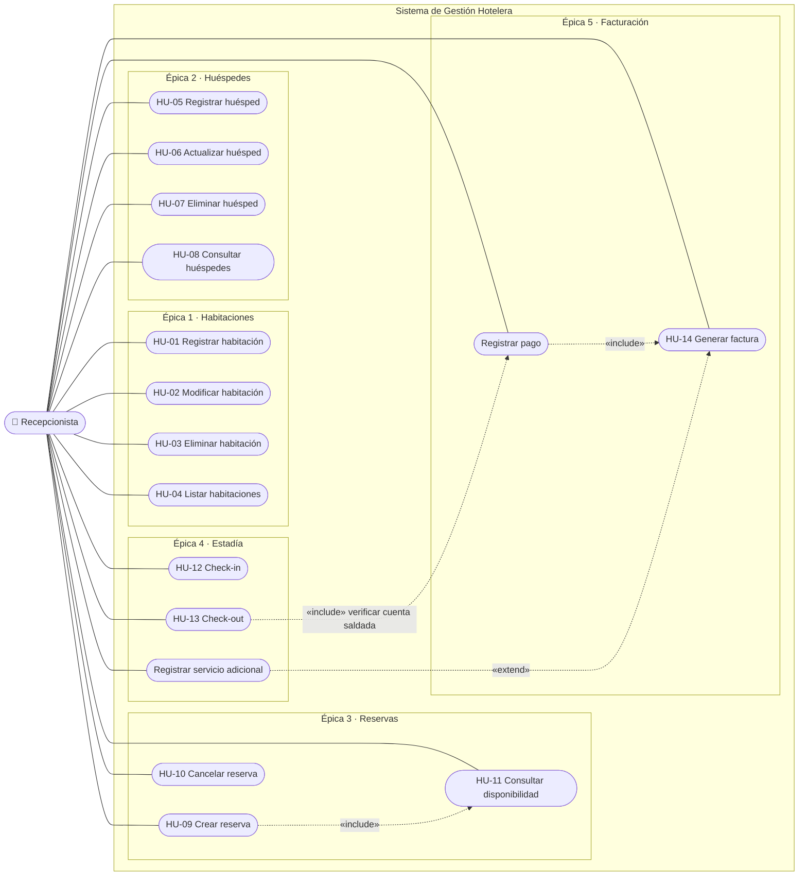
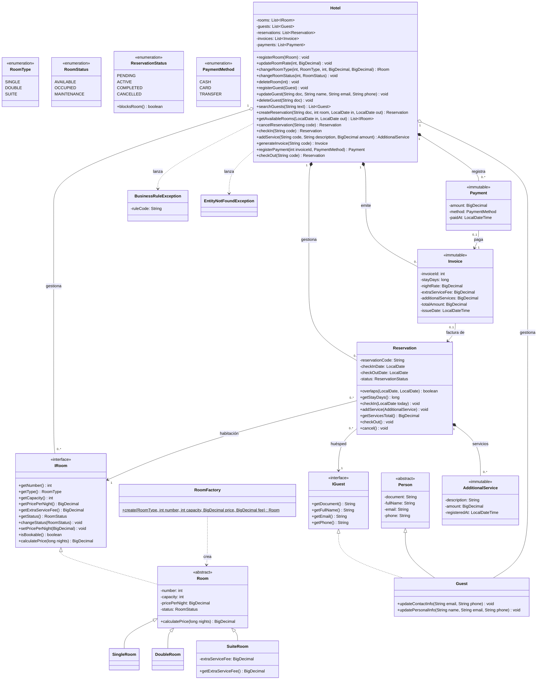
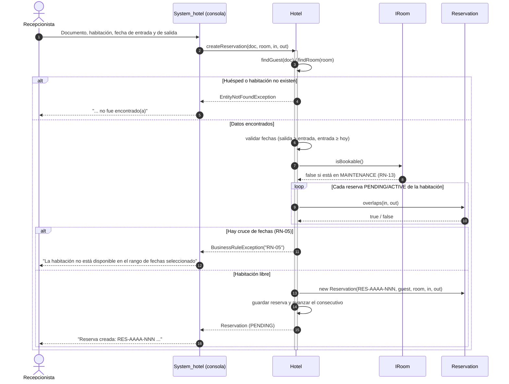
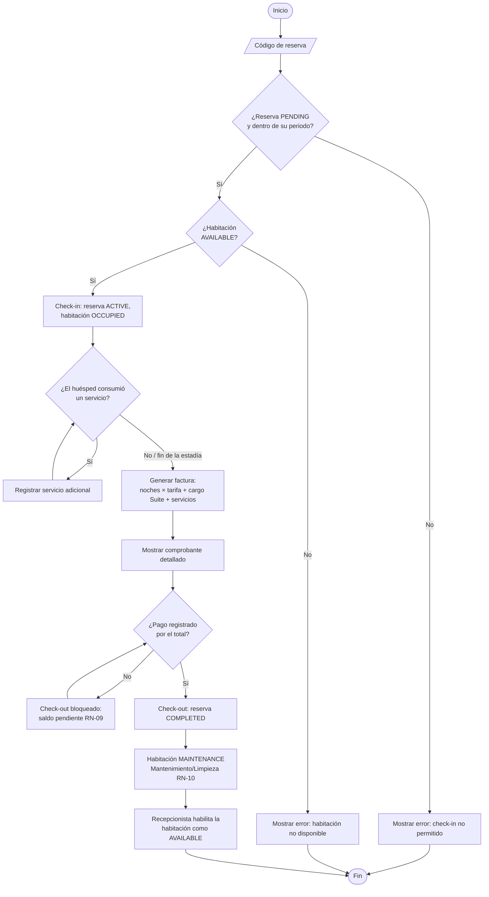

# Diagramas UML — Sistema de Gestión Hotelera (`System_hotel`)

Versión 2.1, alineada con las 14 historias de usuario (Fase 1), el SRS v2.0 (Fase 2), la base de datos `system_hotel_db` (Fase 4) y el código Java (Fase 6).

Los diagramas están en **Mermaid**, que GitHub muestra directamente. Las imágenes de `Diagrams/` se generan a partir de este mismo código.

| Diagrama | Imagen |
| :--- | :--- |
| 1. Casos de uso | `Diagrams/diagrama_casos_de_uso.png` |
| 2. Clases | `Diagrams/diagrama_clases_hotel.png` |
| 3. Secuencia (crear reserva) | `Diagrams/diagrama_secuencia.png` |
| 4. Actividades (estadía: servicios, factura, pago y check-out) | `Diagrams/diagrama_actividades.png` |

---

## 1. Diagrama de casos de uso

Un único actor opera el sistema: el **Recepcionista** (SRS 2.3). El huésped es sujeto de los datos y no interactúa con el sistema. Cada caso de uso corresponde a una historia de usuario (HU) y a un requisito funcional (RF) con el mismo número.

---

## 2. Diagrama de clases

Herencia e interfaces: `IRoom` ← `Room` (abstracta) ← `SingleRoom` / `DoubleRoom` / `SuiteRoom`; `IGuest` + `Person` (abstracta) ← `Guest`. `Hotel` concentra las reglas de negocio y depende de las interfaces (principio de inversión de dependencias). El dinero usa `BigDecimal` (`DECIMAL` en la BD) y los estados son enums.

---

## 3. Diagrama de secuencia — Crear reserva (HU-09)

Muestra cómo se validan las reglas RN-05 (sin cruce de fechas) y RN-13 (no reservar en el pasado ni en mantenimiento).

---

## 4. Diagrama de actividades — Estadía, facturación y check-out (HU-12 a HU-14)

