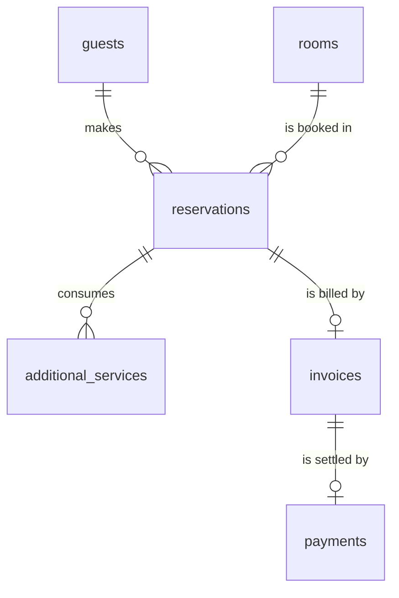

# Phase 4: Relational Database Module (`system_hotel_db`) — v2.1

## 📌 Overview

This module contains the schema creation script and seed data for the **System Hotel** relational database. The structure follows Third Normal Form (3NF) and enforces referential integrity with primary keys, foreign keys, `CHECK` constraints and triggers.

Version 2.1 covers the 14 user stories of Phase 1 and the SRS v2.0 (RF-01 to RF-14, RN-01 to RN-15). It adds additional services consumed during the stay, payments (so check-out can require a settled account) and logical deletion of guests. See `docs/MATRIZ_TRAZABILIDAD.md` for the full requirement → class → table mapping.

## 🛠️ Execution Environment

- **Database Engine:** MySQL 8.0.16+ (required for `CHECK` constraints)
- **Container Environment:** Docker Desktop (`mysql-container`)
- **Port Mapping:** `3306:3306`
- **Database Client Tool:** MySQL Workbench

## 📐 Relational Schema & Data Dictionary



### 1. `guests` — class `Guest` (extends `Person`)

| Column | Type | Constraints | Description |
|---|---|---|---|
| `id` | SMALLINT UNSIGNED | PK, AUTO_INCREMENT | Internal identifier |
| `document` | VARCHAR(10) | UNIQUE, NOT NULL, CHECK 6–10 digits | Colombian ID number (RN-03) |
| `full_name` | VARCHAR(60) | NOT NULL | Guest full name |
| `email` | VARCHAR(80) | NOT NULL, CHECK format | Contact email |
| `phone` | CHAR(10) | NOT NULL, CHECK 10 digits | Mobile phone, without `+57` |
| `is_active` | BOOLEAN | DEFAULT TRUE | HU-07 logical delete (RN-04) |
| `created_at` | TIMESTAMP | DEFAULT CURRENT_TIMESTAMP | Registration date |

### 2. `rooms` — interface `IRoom`, classes `SingleRoom` / `DoubleRoom` / `SuiteRoom`

Inheritance is mapped as a **single table**: `type` acts as the discriminator column.

| Column | Type | Constraints | Description |
|---|---|---|---|
| `id` | SMALLINT UNSIGNED | PK, AUTO_INCREMENT | Internal identifier |
| `room_number` | SMALLINT UNSIGNED | UNIQUE, NOT NULL, > 0 | Room number (RN-01) |
| `type` | ENUM('SINGLE','DOUBLE','SUITE') | NOT NULL | Enum `RoomType` |
| `capacity` | TINYINT UNSIGNED | NOT NULL, > 0 | Maximum occupancy |
| `price_per_night` | DECIMAL(10,2) | NOT NULL, > 0 | Nightly rate (COP) |
| `extra_service_fee` | DECIMAL(10,2) | DEFAULT 0, ≥ 0, only SUITE | Fixed fee per stay |
| `status` | ENUM('AVAILABLE','OCCUPIED','MAINTENANCE') | DEFAULT 'AVAILABLE' | Enum `RoomStatus`. `MAINTENANCE` = "Mantenimiento/Limpieza", set after check-out (RN-10) |
| `is_active` | BOOLEAN | DEFAULT TRUE | HU-03 logical delete (RN-02) |

### 3. `reservations` — class `Reservation`, enum `ReservationStatus`

| Column | Type | Constraints | Description |
|---|---|---|---|
| `id` | INT UNSIGNED | PK, AUTO_INCREMENT | Internal identifier |
| `reservation_code` | VARCHAR(15) | UNIQUE, NOT NULL, CHECK `RES-YYYY-NNN` | Public code |
| `guest_id` | SMALLINT UNSIGNED | FK → `guests.id`, RESTRICT | Guest |
| `room_id` | SMALLINT UNSIGNED | FK → `rooms.id`, RESTRICT | Room |
| `check_in_date` | DATE | NOT NULL | Arrival date |
| `check_out_date` | DATE | NOT NULL, > `check_in_date` | Departure date (exclusive) |
| `status` | ENUM('PENDING','ACTIVE','COMPLETED','CANCELLED') | DEFAULT 'PENDING' | Lifecycle state |
| `created_at` | TIMESTAMP | DEFAULT CURRENT_TIMESTAMP | Creation date |

Index `ix_reservations_overlap (room_id, status, check_in_date, check_out_date)` supports the RN-05 / RN-07 overlap query.

### 4. `additional_services` — class `AdditionalService`

| Column | Type | Constraints | Description |
|---|---|---|---|
| `id` | INT UNSIGNED | PK, AUTO_INCREMENT | Internal identifier |
| `reservation_id` | INT UNSIGNED | FK → `reservations.id`, RESTRICT | Stay that consumed the service |
| `description` | VARCHAR(80) | NOT NULL | e.g. Minibar, Lavandería |
| `amount` | DECIMAL(10,2) | NOT NULL, > 0 | Value (COP) |
| `registered_at` | TIMESTAMP | DEFAULT CURRENT_TIMESTAMP | Registration date |

Trigger `trg_services_not_invoiced` rejects new services for a stay that already has an invoice (RN-12).

### 5. `invoices` — class `Invoice`

Issued while the reservation is `ACTIVE`, before check-out.

| Column | Type | Constraints | Description |
|---|---|---|---|
| `id` | INT UNSIGNED | PK, AUTO_INCREMENT | Invoice number |
| `reservation_id` | INT UNSIGNED | UNIQUE, FK → `reservations.id`, RESTRICT | 1 stay : 1 invoice |
| `stay_days` | SMALLINT UNSIGNED | NOT NULL, > 0 | Nights billed (reservation nights) |
| `night_rate` | DECIMAL(10,2) | NOT NULL, > 0 | Rate copied at issue time |
| `extra_service_fee` | DECIMAL(10,2) | DEFAULT 0 | Suite fee copied at issue time |
| `additional_services` | DECIMAL(10,2) | DEFAULT 0 | Sum of the stay's `additional_services` |
| `total_amount` | DECIMAL(12,2) | CHECK = days × rate + fee + services | Total (COP), RN-11 |
| `issue_date` | TIMESTAMP | DEFAULT CURRENT_TIMESTAMP | Issue timestamp |

Triggers `trg_invoices_no_update` and `trg_invoices_no_delete` enforce **RN-12 (invoice immutability)**.

### 6. `payments` — class `Payment`, enum `PaymentMethod`

Kept apart from `invoices` so invoices stay immutable. A paid invoice means the account is settled and check-out is allowed (RN-09).

| Column | Type | Constraints | Description |
|---|---|---|---|
| `id` | INT UNSIGNED | PK, AUTO_INCREMENT | Internal identifier |
| `invoice_id` | INT UNSIGNED | UNIQUE, FK → `invoices.id`, RESTRICT | 1 invoice : 1 full payment |
| `amount` | DECIMAL(12,2) | NOT NULL, > 0 | Must equal the invoice total |
| `method` | ENUM('CASH','CARD','TRANSFER') | NOT NULL | Payment method |
| `paid_at` | TIMESTAMP | DEFAULT CURRENT_TIMESTAMP | Payment date |

Trigger `trg_payments_full_amount` rejects a payment that does not match the invoice total.

## 🧪 Seed Data

Same rooms and guests as `System_hotel.loadSeedData` (Java) and the Phase 5 prototype:

- **Rooms:** 101 SINGLE $120.000 · 102 DOUBLE $200.000 · 201 SUITE $350.000 + $50.000 fee · 202 SINGLE $120.000 in `MAINTENANCE`.
- **Guests:** Carlos Pérez, Ana María Gómez, Luis Fernando Torres.
- **History:** `RES-2026-001` (Suite 201, 5 nights) with a Lavandería service of $30.000, invoice of **$1.830.000** (5 × 350.000 + 50.000 + 30.000) paid by card, and `COMPLETED`. `RES-2026-002` is a future `PENDING` reservation.

The history rows are inserted in the real order of the flow (stay `ACTIVE` → service → invoice → payment → `COMPLETED`) so the triggers accept them.

## 🔄 Changes

| Version | Change | Reason |
|---|---|---|
| 2.0 | `reservations.reservation_id` → `reservation_code` | Avoid confusion with FK `invoices.reservation_id` |
| 2.0 | `invoices` FK `ON DELETE CASCADE` → `RESTRICT` + triggers | Invoices are immutable (RN-12) |
| 2.0 | Added `invoices.extra_service_fee` and `rooms.is_active` | Separate suite fee; HU-03 delete without losing history |
| 2.0 | `CHECK` constraints for dates and formats | Data integrity (RNF04) |
| 2.1 | Added `additional_services` | HU-14: services registered during the stay |
| 2.1 | Added `payments` + `trg_payments_full_amount` | HU-13 / RN-09: check-out requires a settled account |
| 2.1 | Added `guests.is_active` | HU-07 logical delete (RN-04) |
| 2.1 | `trg_services_not_invoiced` | No services after the invoice is issued (RN-12) |
| 2.1 | Rule codes renamed (`BR-xx` → `RN-xx`) | One rule list, as in the SRS v2.0 |

## 🚀 Deployment & Execution Instructions

### 1. Launch Container

```bash
docker start mysql-container
```

### 2. Run the script

```bash
docker exec -i mysql-container mysql -uroot -p < script_hotel_db.sql
```
